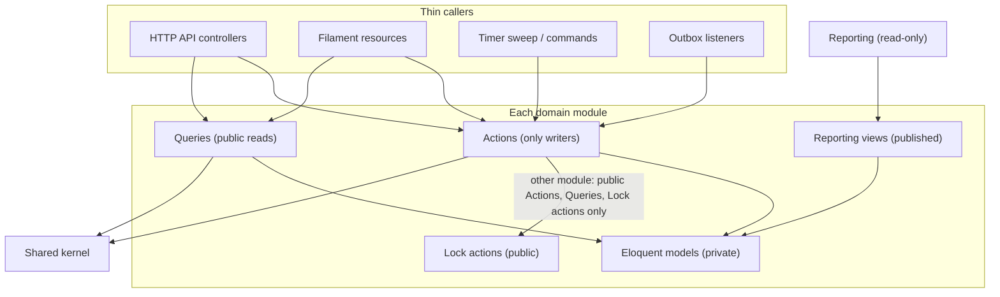
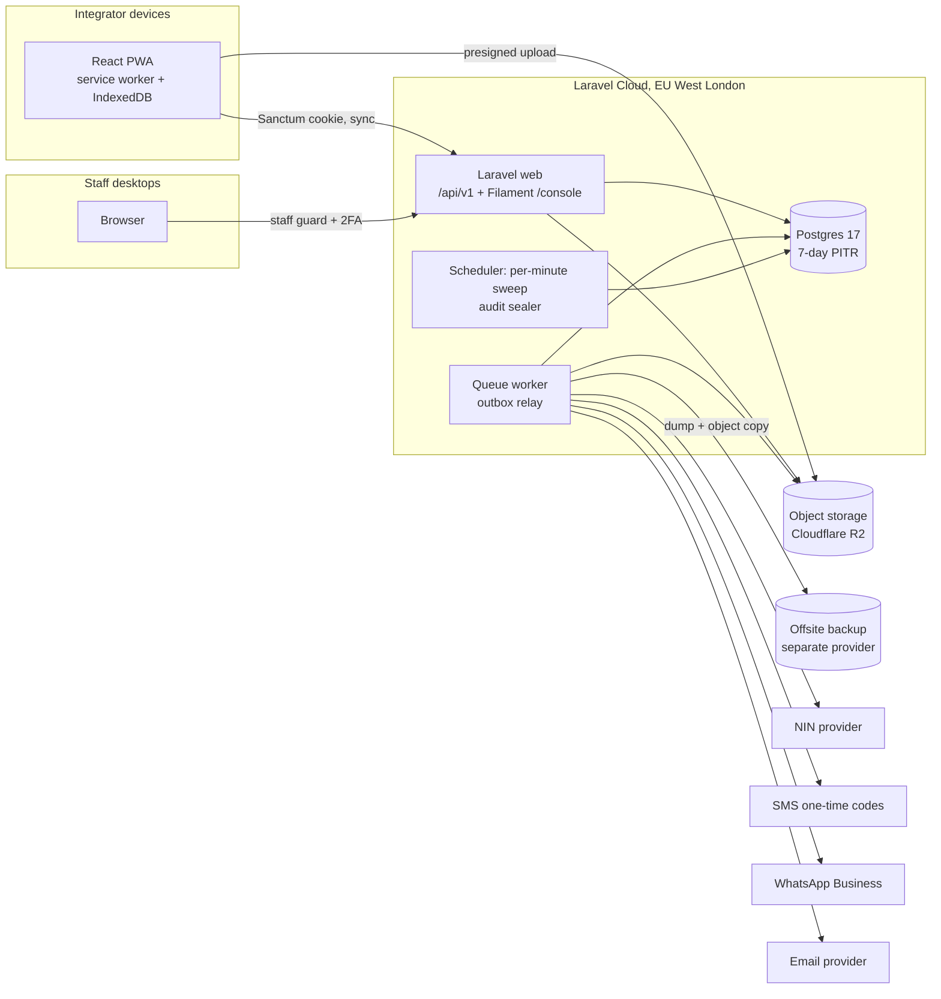
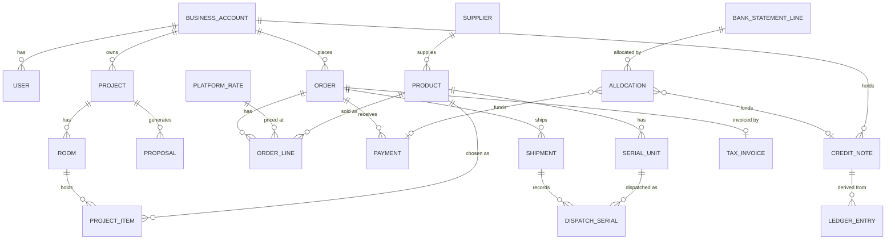

# Architecture Spine — integrator

## Design Paradigm

**Modular monolith with a single write path.** One Laravel application, one PostgreSQL database, one deployment. The backend is cut into domain modules; each module owns its tables, and every state change goes through that module's **Action** classes. HTTP controllers, Filament resources, console commands, the timer sweep and queued listeners are thin callers of Actions. The Integrator app is a separate React client in the same repository, served by Laravel and talking only to the JSON API.

| Module | Owns (tables and rules) | FRs |
| --- | --- | --- |
| `Shared` (kernel, no domain tables) | Money type, Clock (UTC store, WAT display), Business Hours arithmetic, UUIDv7, Action base, lock registry, transition-table helper, idempotency store, outbox, field-visibility registry, `PdfRenderer` contract | NFR-4, NFR-9, NFR-10 |
| `Identity` | Users, Business Accounts, roles, Access Levels, NIN records, Vouch Codes, Level 3 requests, Terms acceptances, Holds and blocklist, sessions, step-up grants, personal-data erasure and export orchestration | FR-1–11, FR-69–72 |
| `Catalogue` | Products, Product Ranges, Suppliers and the Active Supplier, sellability flags (quarantine, suspected), stock quantities, reservations, goods-in, batches, serial units, stock ledger, back-order config, catalogue media | FR-12–18, FR-73, FR-74 |
| `Pricing` | Platform Rate (versioned), Platform Markup, margin floor, VAT, Loyalty Tiers and history, quotes and Order Quotes, every price, VAT, margin, delivery, credit and fee formula, the NGN 5 tolerance | FR-19–24, FR-35 |
| `Projects` | Projects and their revision, Rooms, Project Items, Proposals and their PDFs, sync operations, tombstones and conflicts | FR-25–32 |
| `Orders` | Carts, Orders and Order Lines and all their statuses (including Approved, Completed, line credits, back-order markers), Price Lock, cancellation and amendment, Payments, Receipts, bank-statement lines and allocations, platform bank details | FR-33–42, FR-57, FR-75 |
| `CreditNotes` | Credit Note ledger, tax invoices, credit-note documents, delivery notes, document numbering | FR-43, FR-77 |
| `Fulfilment` | Approval workflow, Shipments (normal and replacement), dispatch serials, Delivery Zones, Zone Rates, Stores | FR-44–47, FR-56, FR-65 |
| `Documentation` | Per-Product guides, manuals, videos, and their replace and withdraw lifecycle | FR-48–50 |
| `Notifications` | Templates, WhatsApp opt-ins, delivery log with fallback and quiet-hours deadlines | FR-51 |
| `Returns` | Cases, serial lookup, Issue Codes, Return Requests, investigations, remedies, counterfeit cases | FR-58–68, FR-79 |
| `Staff` | Staff accounts and roles, audit trail, pending approvals, work items, deputies, holiday calendar | FR-52, FR-53, FR-76, FR-78 |
| `Reporting` (read-only) | Dashboard and exports over owner-published reporting views | FR-80 |

## Invariants & Rules



### AD-1 — Actions are the only writers [ADOPTED]

- **Binds:** all modules; API controllers, Filament, sweep, listeners
- **Prevents:** money, state and audited fields changed outside the locking and audit path
- **Rule:** Any insert, update or delete of a module's tables happens inside one of that module's Action classes. Callers never call `save()`, `update()`, `delete()` or `create()` on a model. Every Filament create, edit, delete and button calls an Action; each module's base Filament Resource overrides record creation and update to do so, with no carve-out for "plain" fields. An architecture test fails the build on a model write outside `Actions/`.

### AD-2 — Strict module boundaries [ADOPTED]

- **Binds:** all modules
- **Prevents:** hidden coupling, second writers, and derived figures computed differently by different modules
- **Rule:** A module uses another module only through that module's public `Actions`, `Queries` and `Lock` actions. It never imports another module's Eloquent models and never queries another module's tables. Queries return DTOs or read models, not Eloquent models. `Reporting` reads only versioned **reporting views** that each owning module publishes in its own migrations, with derived figures (balances, statuses, net spend, VAT) computed in the view by the owner's rules and a contract test in the owner's suite. A module's view selects only from its own tables. Reporting never writes.

### AD-3 — Filament lives inside each module [ADOPTED]

- **Binds:** staff console (FR-52, FR-78, all console screens in EXPERIENCE.md)
- **Prevents:** the console becoming a cross-module shortcut or a second write path
- **Rule:** Each module registers its own Filament resources over its own models. A cross-module column in a queue comes from the owning module's Query or published view; cross-module joins happen in the consuming resource over two owners' read paths. Every console action calls an Action under AD-1.

### AD-4 — The Action contract [ADOPTED]

- **Binds:** every Action, especially NFR-10's money-affecting transitions
- **Prevents:** races where two writers both succeed; deadlocks between modules; retries that double-apply; lost or out-of-order side effects; state changes without an audit row
- **Rule:** An Action:
  1. **Locks up front, in one order.** The entry Action (the one a caller invokes) acquires every aggregate root it will touch before calling any nested Action, through each owner's public `Lock{Root}` action (`SELECT … FOR UPDATE`), in this global order: Business Account (ascending id) → Project → Proposal → Order (ascending id) → Shipment → Payment and statement line → Return Request and Case → Credit Note (ascending id) → Product and stock rows (ascending Product id) → document counter rows. Nested Actions join the caller's transaction, assert through `Shared`'s lock registry that their root is already held, and never lock on their own. Creating an Order locks its Business Account first. A fan-out change (counterfeit hold, rate change, bank-detail change) never locks more than one Order: it changes its own row and emits an event that drives one per-entity Action per affected Order, Proposal or Cart.
  2. **Checks a declared transition.** Every stateful entity has a transition table in code, published by its owning module: states, moves, allowed actor roles and required evidence, with names from the PRD Glossary and addendum status model. A move not in the table is refused.
  3. **Refuses cleanly.** Inside a joined transaction a refusal throws a typed `TransitionRefused`; only the entry Action converts it, to a result or to HTTP `409` with the current resource. A partial outcome (FR-18 partial reservation) is an explicit return type, never an ignored value.
  4. **Is idempotent.** Client-retryable operations (create Order, upload intent, cancel, amend, Vouch Code redemption, sync push, Credit Note request) require an `Idempotency-Key`, stored in `Shared`'s idempotency store, unique per (actor, operation, key) with a request hash. A replay returns the original result; the same key with a different payload returns `422`.
  5. **Audits in the transaction** through `Staff`'s audit Action (AD-21), naming the actor (User, staff member, or `system`) with `acting_as` and `acting_for` where a deputy or role switch applies.
  6. **Emits events through an outbox.** Domain events are rows in `Shared`'s outbox, written in the same transaction, relayed at least once by the worker and the sweep, and keyed by event id. Listeners are idempotent on event id. A cross-module reaction required for correctness either runs synchronously inside the entry Action or is outbox-driven. A listener that calls a provider records a delivery key (event id plus channel) under a unique constraint before calling it. User-facing events carry the facts the message states, captured at emit time, and a per-aggregate sequence number; a listener drops an event older than the last one sent for that aggregate.

### AD-5 — Timers are deadline columns plus a sweep [ADOPTED]

- **Binds:** FR-20 staleness, FR-32, FR-38, FR-41, FR-43 expiry and reminders, FR-45 Uncollected, FR-21 monthly tiers, FR-68 Issue Code, FR-51 fallback and quiet hours, FR-78 escalation, NFR-3 30-day NIN deletion, NFR-9
- **Prevents:** lost expiries from dropped delayed jobs; a timer that fires after the user already acted; each epic inventing its own reminder flags; clients computing deadlines differently from the server
- **Rule:** Every business deadline is a UTC timestamp column on its owning entity. A sweep runs every minute on one server (`onOneServer`, using the shared cache lock), finds due rows and calls the same Actions a person would. Each timer Action re-reads its deadline under the root lock and refuses unless the deadline has passed by database transaction time. A reminder is a `*_due_at` and `*_sent_at` column pair (for example `pickup_reminder_due_at` and `pickup_reminder_sent_at`) set and consumed by a dedicated reminder Action such as `SendPickupReminder`. A pausable clock stores `paused_at` and `remaining_seconds`. Business-Hours deadlines are computed by `Shared` over `Staff`'s holiday calendar, and a calendar change recomputes every open Business-Hours deadline. No per-entity delayed queue jobs; queue backoff is allowed only for provider transport retries. The API sends every deadline as a server-computed UTC `*_at` and every response carries server time, and the PWA never does Business-Hours arithmetic. A missed sweep heartbeat or failed run alerts the founder.

### AD-6 — Money is never a float [ADOPTED]

- **Binds:** all modules, the API, the PWA (NFR-4)
- **Prevents:** rounding drift between PHP, JavaScript and the database; kobo differences from re-multiplying rounded intermediates
- **Rule:** Money is PostgreSQL `numeric` with fixed scale: NGN to 2 decimal places, USD costs to 4. Platform Rate is `numeric(12,4)`; percentages (markup, discounts, VAT, floor, margin) are `numeric(7,4)`. Records store **inputs** (cost, percentages, rate version) and **final rounded naira** only; a derived USD or intermediate figure is never stored and later re-multiplied. FR-19's rounding happens only in the `Shared` Money type, at full precision, once. In JSON, money is `{"amount": "<decimal string>", "currency": "NGN"|"USD"}`. The PWA has one TypeScript money module (integer kobo as `BigInt`, parsed from the decimal string) for display sums; it never computes a price that is persisted or sent to the server.

### AD-7 — Pricing owns every formula [ADOPTED]

- **Binds:** Pricing, Projects, Orders, CreditNotes, Fulfilment, Returns, Reporting (FR-19–24, FR-30, FR-35, FR-37, FR-38, FR-43, FR-61, FR-77)
- **Prevents:** several modules computing prices, VAT splits, delivery charges, credits or fees differently, so that invoices, Credit Notes and the VAT export fail to reconcile
- **Rule:** `Pricing` alone multiplies, divides, applies VAT to, or applies a percentage to money. It exposes:
  - `QuoteLines(lines, account, rate_version, tier_as_of)` returning a **price snapshot** (a versioned DTO whose shape Pricing alone defines, carrying per line the Platform Rate version, Tier Discount, Back-order Discount and type, VAT rate, unit USD cost, Platform Markup, Active Supplier and Lead Time, plus delivery) and an **Order Quote** (`quote_id` and a fingerprint over rate version, tier, Proposal id and revision, back-order terms and availability);
  - `RepriceSnapshot(snapshot, rate_version)`, which changes only the exchange rate and applies the FR-35 tolerance, and is the only sanctioned recompute of a stored snapshot;
  - `PriceDelivery`, `SplitVat`, `ApplyIntegratorMargin`, `RestockingFee` and the credit-amount formulas (shortfall, line credit, freed-Shipment delivery, Credit Note VAT component).

  Proposals, Orders and Order Lines store snapshots as returned; an Order keeps both its original and any repriced snapshot, each stamped with the instant used. The addendum's test vectors live in Pricing's test suite.

### AD-8 — Catalogue owns stock, sellability and serial units [ADOPTED]

- **Binds:** Catalogue, Orders, Fulfilment, Returns, Projects (FR-12, FR-16–18, FR-65–67, FR-74)
- **Prevents:** stock changed from several modules; two "Suspected" states; a counterfeit block missed in the gap before a listener runs; two serial tables with different normalisation
- **Rule:** Only `Catalogue` Actions change stock quantities, reservations, the stock ledger, sellability flags, batches or serial units. Other modules call its reserve, release, commit and restock Actions. Returns owns the counterfeit **case** and calls Catalogue `SetSuspected`. Blocking is pull-based: confirming a Payment, reserving stock, dispatching and adding a Project Item each call Catalogue `AssertSellable` under the stock-row lock. Catalogue owns `serial_units` (serial, Product, batch, normalised form, unique); Fulfilment owns dispatch serials referencing them, with a partial unique constraint on active dispatches. Back-order markers on Order Lines are set by an Orders Action that calls Catalogue `AssertGoodsIn`. No Store dimension is assumed outside Catalogue.

### AD-9 — Credit Notes are an append-only ledger with gapless documents [ADOPTED]

- **Binds:** CreditNotes, Orders, Returns, Reporting (FR-43, FR-57, FR-61, FR-77)
- **Prevents:** one Credit Note spent on two Orders; balances edited in place; invoice numbers with gaps or duplicates; a second invoice for one Order
- **Rule:** A Credit Note's life is immutable ledger entries: `issue`, `hold` (application requested), `release` (hold withdrawn), `apply` (completes a hold), `restore` (reverses an apply and keeps the original expiry), `refund`, `expire`. Available balance = issue − holds − applies + restores − refunds − expires, checked under the Credit Note lock by every request, hold and refund; status is derived by one CreditNotes Query. A tax invoice is a **structured record** (lines, VAT, TIN, delivery VAT) and its PDF is a rendering of it. Document numbers come from a counter row per document series, locked `FOR UPDATE` last in the AD-4 order, so they are gapless. One invoice per Order (unique constraint). Reversing a Payment after its invoice issues a credit-note document, and a re-Paid Order gets a new invoice. A credit-note document references the invoice it adjusts when one exists, otherwise the Order reference.

### AD-10 — A bank credit is allocated at most once in total [ADOPTED]

- **Binds:** Orders (FR-40–42, edge rows 54–55), bank-statement import
- **Prevents:** a reused or forged Receipt confirmed against an already-used credit; a double CSV import creating a second copy of one credit; split transfers that the schema cannot represent
- **Rule:** Statement lines belong to `Orders` and carry a natural-key unique constraint (account, value date, amount, bank reference), so re-importing a file changes nothing. Confirmation creates `statement_line_allocations` rows (statement line to a Payment or a Credit Note, with an amount); a database trigger keeps the sum of a line's allocations at or below its amount. Allocations are append-only, corrected by compensating rows. A split across Orders needs a second approver (AD-23).

### AD-11 — UUIDv7 keys everywhere [ADOPTED]

- **Binds:** every table, the API, the PWA's local store
- **Prevents:** offline-created rows colliding; mixed id conventions across modules
- **Rule:** Every primary key is a UUIDv7; the PWA generates them with a UUIDv7 library (never `crypto.randomUUID()`, which is v4). Human-facing references (Order reference, document number, Issue Code) are separate columns, never the primary key.

### AD-12 — The offline sync protocol [ADOPTED]

- **Binds:** Projects, Catalogue, Pricing, Documentation, the PWA (FR-28, FR-50, FR-55, NFR-6)
- **Prevents:** each offline feature inventing its own cursor, merge or cache rules; devices silently missing rows; removed users' data or edits lingering
- **Rule:**
  - **Push.** The device sends a queue of operations for Projects, Rooms and Project Items under one idempotency key per batch. The acting User of every operation must equal the session User. The server merges per Room and per Project Item, last writer wins per field by server receipt time; the device clock is never used. Deletion is a `deleted_at` field under the same rule: an edit received after a tombstone resurrects the item and records a conflict. Tombstones are kept for the 30-day restore. Operations from a User removed or re-roled after they were queued are stored as held conflicts for an Owner or Manager to accept or discard, never applied automatically. Every accepted merge, including Unavailable flagging, bumps the Project revision (AD-22). Server and PWA implement the merge from one shared specification with test vectors.
  - **Pull.** Every syncable table carries a `change_seq` from one shared sequence and the writing transaction's `xid8`. A pull returns rows with `change_seq` above the device's cursor whose writing transaction is older than `pg_snapshot_xmin(pg_current_snapshot())`, so out-of-order commits are never skipped. Every syncable table emits tombstones or "left your scope" markers.
  - **Scope.** The Catalogue without prices (filtered by AD-13); for Owners and Managers only, a price sheet covering the Products in the Business Account's Projects and those the User recently viewed, carrying its own cursor (bumped by any rate, tier or markup change) and its own "as of" time, never the whole Catalogue (FR-73); Documentation metadata and saved files, and the Projects of the User's Business Account that the role may see. Carts, Orders, Payments, Receipts and Credit Notes are never stored on the device; money actions need a live connection.
  - **Local store.** One IndexedDB database per User and role; changes live there first. It is purged at the next connection after any change to the User's role, Access Level, Hold or membership. The device stores the server time of its last successful sync and refuses to open saved Projects when 14 days have passed since it or the device clock reads earlier than it. An expired session locks unsynced changes and never purges them. The PWA calls `navigator.storage.persisted()` and `persist()` on every launch, records the result, shows the eviction warning when persistence is not granted, and uses `navigator.storage.estimate()` before saving. Sync runs on demand and on focus or reconnect; Background Sync is only an enhancement.

### AD-13 — One visibility policy for every outbound surface [ADOPTED]

- **Binds:** API, sync, notifications, PDFs, exports, search sort and filter (FR-2, FR-11, FR-30, FR-51, FR-73, PRD §5.1, EXPERIENCE "Who sees what")
- **Prevents:** a money field or staff identity reaching someone only because one surface forgot to filter it
- **Rule:** `Shared` holds a field-visibility registry of field classes (money, cost, USD, staff identity, staff note) keyed by Access Level, role and staff role. API resources, sync payloads, notification renderers (resolved per recipient), PDF builders, exports and sort and filter parameters all consult it on the server. A Technician or a Level 1 or Level 2 user never receives any money field or price-derived ordering; an Integrator never receives Supplier Cost, Platform Markup, USD amounts or staff identity. Staff-entered text is always two columns, `reason_public` and `note_internal`. One test suite runs every Technician, Level 1 and Level 2 surface against the registry.

### AD-14 — Files: evidence is private and immutable, media is cacheable, uploads are staged [ADOPTED]

- **Binds:** Receipts, Proposals, documents, Documentation, Product images, return photos (FR-31, FR-38, FR-40, FR-50, FR-55)
- **Prevents:** the Price Lock depending on which upload path an epic built; unscanned files in use; uncacheable media on slow connections; documents that change after issue
- **Rule:**
  - **Uploads.** Every upload starts with an upload-intent `POST` that stamps `upload_started_at` (the time FR-38 judges) and takes the idempotency key, then returns presigned multipart URLs for resumable upload, and finishes with a completion call. Files sit under a quarantine prefix until a queued step scans for malware, strips EXIF, sniffs type and converts HEIC, then promotes them.
  - **Evidence and private documents** (Receipts, invoices, credit-note and delivery documents, return photos, Proposal PDFs) are private and served through short-lived signed URLs. They are never overwritten, except that regenerating a Proposal hard-replaces its PDF (FR-31) and Proposal PDFs are excluded from object versioning.
  - **Catalogue media and Documentation** use immutable content-hashed keys behind a stable authenticated app route, cacheable long-term by the service worker. Images get fixed derivatives at upload (320, 640 and 1280 px, WebP).
  - **Documents** are rendered on the queue, through `Shared`'s `PdfRenderer` contract, only from a snapshot row written in the issuing transaction. The Parts-list PDF needs a connection in v1.

### AD-15 — External providers sit behind module interfaces [ADOPTED]

- **Binds:** Identity (NIN check, SMS one-time codes, bot check), Notifications (email, WhatsApp), Orders (bank-statement CSV import), file scanning
- **Prevents:** provider SDK calls spread through Actions; a provider swap becoming a rewrite
- **Rule:** Each external provider is reached only through an interface owned by the module that uses it, with a production adapter and a fake. Staging and tests bind the fakes. Provider calls happen in outbox listeners or a dedicated Action step, never inside another module's transaction, and record a delivery key per AD-4.6.

### AD-16 — NIN is protected by its own keys [ADOPTED]

- **Binds:** Identity (FR-4, NFR-3), backups (AD-20)
- **Prevents:** NIN readable with the app key or recoverable from a backup after deletion; NIN leaking into logs; a restore elsewhere without keys
- **Rule:** Each full NIN is encrypted with its own data key, wrapped by a dedicated master key (never `APP_KEY`); deleting the wrapped data key crypto-shreds the NIN in every backup. The 30-day deletion is a deadline column under AD-5. The uniqueness hash uses a separate HMAC key. Master and HMAC keys live in the host's secret store and are escrowed in a second secret store outside Laravel Cloud, tested in the quarterly restore drill. NIN fields are excluded from logs, exception reports, queue payloads, outbox payloads, analytics and exports; staff reveal is an audited Action.

### AD-17 — Search runs on PostgreSQL and on the device [ADOPTED]

- **Binds:** Catalogue search (FR-73, typo-tolerant search in EXPERIENCE.md)
- **Prevents:** a separate search server, and a second index that drifts from the database
- **Rule:** Server-side search uses PostgreSQL `pg_trgm` over name, brand, model and SKU. Offline, the PWA searches an index it builds from its synced Catalogue. There is no external search engine in v1.

### AD-18 — Two authentication surfaces and one step-up [ADOPTED]

- **Binds:** Identity, Staff, CreditNotes, the API, the console (FR-10, FR-52, FR-71)
- **Prevents:** Integrator sessions reaching staff screens; sessions surviving removal; a one-time code proven for one action reused for another
- **Rule:** The PWA authenticates with Laravel Sanctum's SPA cookie mode, served from the same site as the API. Staff authenticate through a separate guard for the Filament console with mandatory two-factor authentication. A User account never gains staff access, and a staff account never uses the PWA. Sessions use the database driver so Identity can revoke every session of a User on removal, deactivation or Hold. Step-up is an Identity-owned `StepUpGrant` (user, action type, target id, expiry, consumed_at): the code travels with the action request, and the gated Action consumes the grant through Identity's public Action inside its own transaction.

### AD-19 — The Integrator app is a local-first React PWA [ADOPTED]

- **Binds:** all Integrator-facing surfaces (phone and desktop, EXPERIENCE.md)
- **Prevents:** the app splitting into a server-rendered half and an offline island with two data models
- **Rule:** The Integrator app is a single React and TypeScript single-page app, built by Vite into Laravel's public assets and served by Laravel. Offline-capable screens read and write the local store (AD-12). Online-only screens call the JSON API through TanStack Query. No Inertia and no Livewire in the Integrator app, and no Blade pages except the shell.

### AD-20 — Managed hosting with no lock-in, and an offsite copy [ADOPTED]

- **Binds:** deployment and operations (NFR-5, NFR-8, NFR-9)
- **Prevents:** code tied to one host; an outage or residency ruling forcing a rewrite; data lost with the provider
- **Rule:** Production runs on Laravel Cloud (Growth plan, EU West London) with Serverless Postgres 17, a managed queue, the task scheduler and Laravel Cloud object storage (Cloudflare R2). Code uses only standard PostgreSQL, the S3 API and standard Laravel queues, cache, sessions and scheduling, with the database driver for cache, locks and rate limits; no features that only Laravel Cloud has. An encrypted logical database dump and a copy of object storage go to a separate provider outside Laravel Cloud every hour, so NFR-5's 1-hour recovery point holds even if Laravel Cloud fails; the quarterly restore drill restores from that copy into a clean environment and recreates the audit trigger and database roles before any write. Three environments: local, staging (the full stack with fake providers and synthetic data only, never production data) and production. The founder receives all alerts: sweep heartbeat, outbox backlog, failed jobs, backup and restore-drill failures, and spend alerts.

### AD-21 — The audit trail is append-only, tamper-evident and free of personal data [ADOPTED]

- **Binds:** Staff, every module's Actions, Reporting (FR-53, NFR-3, FR-72)
- **Prevents:** audit rows edited or deleted; every writer serialising on one chain row; personal data locked into an immutable chain
- **Rule:** Actions insert audit rows with a `bigserial` sequence and no hash, inside their transaction. A single-writer sealing job run by the sweep computes the hash chain in sequence order. A database trigger rejects `UPDATE` and `DELETE` on the audit table; the application runs under a least-privilege role without them where the host allows it (Open Question 1), and otherwise tamper evidence rests on the chain plus the offsite copy. Audit diffs record personal-data fields as "changed" or a keyed hash, never as values; each module keeps a list of its personal-data columns. Every read of a NIN or bank detail goes through an audited Action, including reads for exports.

### AD-22 — The Project revision binds Proposals and Orders [ADOPTED]

- **Binds:** Projects, Pricing, Orders, the PWA (FR-29–35, edge rows 37, 41)
- **Prevents:** "Project changed since the Proposal" firing differently online and after sync; Orders comparing item lists their own way; the Proposal Rate applied twice
- **Rule:** `Projects` owns a monotonic `revision` on each Project, bumped by every item or quantity change, including sync merges and Unavailable flagging. A Proposal stores the revision it was made from. Creating an Order sends the `quote_id` the user saw; the server re-quotes and, on any fingerprint mismatch, returns `409` with the new quote. The Proposal Rate is consumed by Projects' `ConsumeProposalRate` Action, called by Order creation under the Project lock.

### AD-23 — Two-person approval and segregation of duties are one mechanism [ADOPTED]

- **Binds:** Pricing, CreditNotes, Orders, Catalogue, Fulfilment, Returns, Staff (FR-20, FR-41, FR-43, FR-52, FR-66, EXPERIENCE "Trust and verification")
- **Prevents:** seven modules each inventing a pending-change flag with different "requester is not approver" checks
- **Rule:** `Staff` owns `PendingApproval` (requester, approver, reason, payload reference, expiry) with a database check that approver differs from requester. A two-person change is split into a Request Action and an Approve Action, and the effect happens only inside Approve. Every segregation-gated Action calls `Staff`'s `StaffRelationshipQuery(staff, business_account)` to refuse a staff member acting on a business they created, approved or vouched for.

### AD-24 — Staff work items are one table [ADOPTED]

- **Binds:** Staff and every module with a staff queue (FR-76, FR-78)
- **Prevents:** five modules modelling assignment, due time and escalation five ways; reassignment that cannot reach another module's rows
- **Rule:** `Staff` owns `work_items` (queue, subject reference, owner, `due_at`, `escalate_at`, `closed_at`, `acting_for`) as the only assignment and SLA record. Modules open and close items only through Staff Actions, in the same transaction as the state change. The sweep drives escalation from `escalate_at`; deputy reassignment touches only this table.

### AD-25 — Orders alone writes Order status [ADOPTED]

- **Binds:** Orders, Fulfilment, Returns, Identity, Pricing, Reporting (FR-21, FR-44, FR-45, FR-61, edge row 62)
- **Prevents:** an Order completed twice or by two modules; replacement Shipments counted as spend; Established status and tier spend computed differently
- **Rule:** Only `Orders` writes Order and Order Line status, including Approved, Completed, Cancelled and line credits, through `ApproveOrder`, `CreditOrderLine` and `EvaluateCompletion`, which Fulfilment calls synchronously within its entry Action. A Shipment has `kind` normal or replacement; replacements are excluded from completion, spend, invoices and Established counts by the owners' Queries. Orders publishes `NetDeliveredGoodsQuery`, the only source of spend for Loyalty Tiers, Established Integrator status and Reporting.

### AD-26 — Personal-data erasure and export are orchestrated [ADOPTED]

- **Binds:** every module holding personal data (FR-72, NFR-3, edge row 8)
- **Prevents:** account closure or a data-subject request missing data held in another module
- **Rule:** Each module that holds personal data implements `ErasePersonalData(business_account)` and `ExportPersonalData(business_account)` Actions, registered with `Identity`, which orchestrates them. Erasure respects retention holds (NFR-8) and pseudonymises where records must be kept.

## Consistency Conventions

| Concern | Convention |
| --- | --- |
| Module layout | `app/Modules/{Module}/` with `Actions/`, `Queries/`, `Locks/`, `Models/`, `Events/`, `Http/`, `Filament/`, `Contracts/` (provider interfaces), `StatusTables/`, `Database/Migrations/`, `Database/Views/`, `Tests/` |
| Naming | Actions are imperative verb plus noun (`ConfirmPayment`, `ReserveStock`). Queries are noun plus `Query`. Events are past tense (`PaymentConfirmed`). Entity and status names use the PRD Glossary and addendum status model word for word. |
| Events | Outbox rows carry event id, aggregate id, per-aggregate sequence, and the facts the reaction needs. Listeners are idempotent on event id. |
| API | Base path `/api/v1`. JSON keys in `snake_case`. Errors use Laravel's `{message, errors}` plus a machine `code`. A lost race returns `409` with `current`. `Idempotency-Key` header. Every response carries `server_time`. |
| Dates and times | Stored and sent as ISO 8601 UTC (`…Z`). Displayed in West Africa Time by the client and console. |
| Money | AD-6 shape and scales everywhere. Arithmetic only in Pricing over the `Shared` Money type. |
| Database constraints | Any invariant expressible as a constraint is also enforced in PostgreSQL (unique, partial unique, check, foreign key, trigger). Foreign keys may cross module tables but are `ON DELETE RESTRICT`; code access may not cross (AD-2). An architecture test checks migrations. |
| Staff-tunable settings | Database rows owned by their module, changed through Actions (and AD-23 where two people are required), never `.env` entries. |
| Ownership of shared settings | Platform bank details: Orders. WhatsApp opt-ins: Notifications (Identity calls it at Terms acceptance). Order Quote and NGN 5 tolerance: Pricing. |
| Logging | Structured JSON. Never NIN, full bank details or file contents. Every log line carries the request id. |
| Tests | Each module tests its own Actions. Every NFR-10 transition has a concurrency test (two racing calls, one winner) and an idempotent-replay test. Architecture tests enforce AD-1, AD-2 and the foreign-key rule. |

## Stack

| Name | Version |
| --- | --- |
| PHP | 8.4 |
| laravel/framework | 13.x (13.35 at authoring) |
| filament/filament | 5.x (5.10 at authoring) |
| laravel/sanctum | 4.x |
| PostgreSQL | 17 (Laravel Cloud Serverless Postgres) |
| React | 19.x |
| TypeScript | 6.0.x (TypeScript 7 once its 7.1 API lands and lint tooling supports it) |
| Vite | 8.x |
| vite-plugin-pwa (Workbox) | 2.x |
| Dexie (IndexedDB) | 4.x |
| @tanstack/react-query | 5.x |
| @tanstack/react-router | 1.x |
| Tailwind CSS | 4.x |
| Hosting | Laravel Cloud, Growth plan, EU West (London); object storage on Cloudflare R2 |

## Structural Seed





```text
app/
  Modules/
    Shared/  Identity/  Catalogue/  Pricing/  Projects/  Orders/
    CreditNotes/  Fulfilment/  Documentation/  Notifications/
    Returns/  Staff/  Reporting/
resources/
  app/          # React PWA source (routes, local store, sync engine, money module, screens)
routes/
  api.php       # /api/v1, delegates to module Http/
tests/
  Architecture/ # AD-1, AD-2 and foreign-key rules
  Flows/        # cross-module and end-to-end flows only
```

## Capability → Architecture Map

| Capability / Area | Lives in | Governed by |
| --- | --- | --- |
| Accounts, levels, vouching, NIN, closure (FR-1–11, 69–72) | Identity | AD-4, AD-13, AD-15, AD-16, AD-18, AD-26 |
| Catalogue, Suppliers, stock, goods-in (FR-12–18, 73, 74) | Catalogue | AD-8, AD-12, AD-14, AD-17, AD-23 |
| Pricing, Platform Rate, tiers (FR-19–24) | Pricing | AD-5, AD-6, AD-7, AD-23, AD-25 |
| Project Designer, offline design (FR-25–28) | Projects + PWA | AD-11, AD-12, AD-19, AD-22 |
| Proposals and PDFs (FR-29–32) | Projects | AD-7, AD-14, AD-22 |
| Cart, Orders, Price Lock, cancel, amend (FR-33–39, 57, 75) | Orders | AD-4, AD-5, AD-7, AD-8, AD-14, AD-22, AD-25 |
| Payments, Receipts, statement matching (FR-40–42) | Orders | AD-4, AD-10, AD-14, AD-15, AD-23 |
| Credit Notes, tax invoices (FR-43, 77) | CreditNotes | AD-7, AD-9, AD-14 |
| Approval, Shipments, serials, Zones, Stores (FR-44–47, 56, 65) | Fulfilment | AD-4, AD-5, AD-8, AD-25 |
| Documentation and offline copies (FR-48–50) | Documentation + PWA | AD-12, AD-14 |
| Notifications (FR-51) | Notifications | AD-4, AD-5, AD-13, AD-15 |
| Staff roles, audit, continuity, queues (FR-52, 53, 76, 78) | Staff + each module's Filament | AD-3, AD-18, AD-21, AD-23, AD-24 |
| Installable app, low bandwidth (FR-54, 55) | PWA | AD-12, AD-14, AD-19 |
| Returns, Cases, counterfeit (FR-58–68, 79) | Returns | AD-4, AD-7, AD-8, AD-9, AD-23 |
| Dashboard and exports (FR-80) | Reporting | AD-2, AD-21 |
| Availability, recovery, timers (NFR-5, NFR-9) | Platform | AD-5, AD-20 |

## Open Questions

| # | Question | Blocks | Owner |
| --- | --- | --- | --- |
| 1 | Whether Laravel Cloud Serverless Postgres allows a least-privilege application role; spike before the Staff epic | AD-21 | Builder |
| 2 | Serial numbers on the tax invoice or on a delivery note; the reversal and re-invoice flow; VAT on delivery and on Credit Notes | AD-9 field set, the CreditNotes epic | Accountant |
| 3 | NDPA transfer basis for London compute and database and for Cloudflare R2 object storage (location to confirm with Laravel Cloud) | AD-20 | Counsel |

## Deferred

| Item | Why it can wait |
| --- | --- |
| NIN, SMS, bot-check, WhatsApp, email and malware-scan providers | Behind AD-15 interfaces; choose on price and Nigerian coverage before the Identity, Notifications and Payments epics |
| PDF engine | Behind `Shared`'s `PdfRenderer` contract (AD-14); one implementation choice |
| Passkey (WebAuthn) library | Inside Identity only; chosen in the authentication epic |
| Offline search library | Inside the PWA only (AD-17) |
| Error tracking and uptime monitoring beyond Laravel Cloud logs | Alerts go to the founder (AD-20); pick a tool before launch |
| CI pipeline and deploy gates | Laravel Cloud deploys from the repository; define with the first epic |
| Retention periods and archival of financial records (NFR-8) | Waiting on counsel and the accountant; data stays in place and the offsite copy is kept until then |
| Stock per Store and transfers | AD-8 keeps it behind one interface; a migration when a second Store holds stock |
| e-invoicing integration | From July 2027; invoices are structured records (AD-9), so it becomes an adapter |
| Wallet, per-Integrator virtual accounts, payment gateway | v2 per PRD §6.2 |
| Weight-based delivery rates, automated courier tracking | v2 per PRD §6.2 |
| Laravel 14 upgrade | Laravel 13 bug fixes end Q3 2027; plan an upgrade window in year one |
| Additional languages | v1 is English only |
